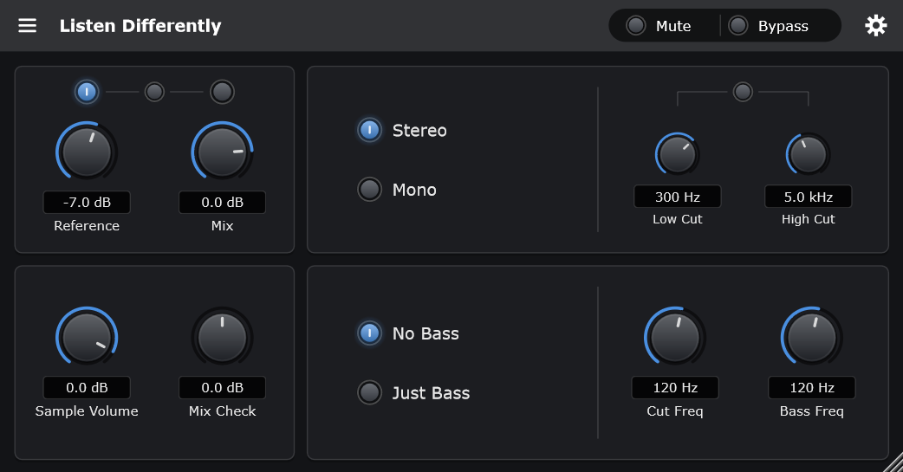

# Listen Differently
The free Listen Differently - mix-monitoring plugin by SpotLight Software



Listen Differently goes on your master channel and gives you quick monitoring tools while you mix. Compare your mix with a reference track, check the low end, cut frequencies, and switch things on and off with one click, without touching your mix.

---

## Features

- **Reference track** – feed a reference track via sidechain and compare it with your mix
- **Bass listen** – hear only the low end to check kick and bass
- **Low cut / High cut** – quickly hear your mix without lows or highs
- **Mute and Bypass** – one-click monitoring controls
- **Custom look** – change colours and background, with colour favourites
- **Remembers window size** – the plugin opens at the size you left it
- **Middle-click** any control to reset it to its default value

<!-- Add or remove features here so they match the current version -->

---

## Download

👉 **[Download the latest version](../../releases/latest)**

1. Open the **Releases** page and download `ListenDifferently.zip`.
2. Unzip the file.

---

## Installation (Windows)

1. Copy `Listen Differently.vst3` to a folder of your choice.
   The plugin can live in any folder. SpotLight Software recommends:
   ```
   Documents\SpotLight Software\Plugins\
   ```
   or another private folder of your own. This keeps all SpotLight plugins in one place, makes them easy to find, and needs no administrator rights.

   You can also use the standard VST3 folder, which DAWs scan automatically:
   ```
   C:\Program Files\Common Files\VST3
   ```
2. If the plugin is not in the standard VST3 folder, add your folder to the list of folders your DAW scans.
   - **FL Studio:** *Options → Manage plugins → Plugin search paths* → add the folder
3. Rescan your plugins.
   - **FL Studio:** *Options → Manage plugins → Find installed plugins*
4. Put **Listen Differently** on the **master channel**, last in the chain.

### Using a reference track (FL Studio)
1. Load your reference track on a separate mixer channel.
2. Route that channel to the master as a **sidechain** (right-click the route arrow → *Sidechain to this track only*).
3. In the plugin, select the sidechain input as the reference.

---

## Requirements

- Windows 10 / 11 (64-bit)
- A DAW that supports VST3 (tested in FL Studio)

---

## Settings

Plugin settings are saved in:
```
Documents\SpotLight Software\Settings\
```
- `listendifferently.sett` – settings for this plugin
- `yourglobal.sett` – shared settings for all SpotLight Software plugins (colour favourites)

New versions read your settings from there, so you keep them after updating.

---

## Privacy

Listen Differently **does not collect or send any personal data**.

- No tracking, no analytics, no ads.
- No registration, account or email address needed.
- No blackmail here! Free means free! It's completely free, and I won't ask you to follow my social media accounts or sign up for anything, simply because it's FREE.
- All settings are stored only on your computer, in `Documents\SpotLight Software\Settings\`.
- The plugin connects to the internet **only when you click**:
  - **Check for update** (in the About window): the plugin connects to GitHub only to read the latest version number. No data about you or your computer is sent. You download the new version yourself from the GitHub page.
  - **links in the About window** (GitHub, Issues, Donate): they open in your web browser.

When you visit GitHub or PayPal, their own privacy policies apply.

---

## Bugs and ideas

Found a bug or have an idea? Open an **[Issue](../../issues)**.
Please include your Windows version, your DAW and its version, and the steps that cause the problem.

---

## Support the project

Listen Differently is free. It is developed by one person in their free time. If the plugin helps your mixes, every donation, big or small, means a lot. It helps me spend more time on new features, bug fixes and new plugins.

☕ **[Donate via PayPal](https://www.paypal.com/donate/?hosted_button_id=JTPM49ZXZCQNG)**

Thank you to everyone who supports the project! ❤️

---

## License

Listen Differently is **freeware**: free to use, closed source.
You may **not** sell, rent or redistribute it. See [EULA.md](EULA.md) for the full terms.

© 2026 SpotLight Software. All rights reserved.
